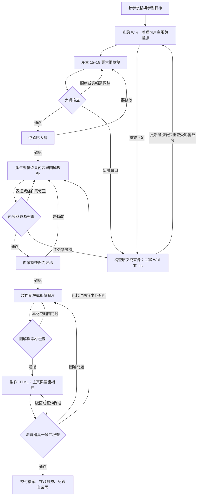

# 教學 HTML 簡報 graph：已確認 v1.0

日期：2026-11-22（Asia/Taipei）  
狀態：`approved`。使用者於 2026-11-22 確認此 graph，並授權先整理大綱。原 [討論草案 v0.1](slides-graph-draft.md) 保留；兩個確認節點及雙用途要求已同步 [AGENTS.md](../AGENTS.md)。graph 確認不等於大綱或逐頁內容已確認。

## 1. 已知需求與本次確認

- 知識來源：已完成 ingest 的 [排球 LLM Wiki](../wiki/index.md)。新增知識必須先回寫 Wiki、檢查，再供簡報使用。
- 對象與成果：室內六人排球初學者，約 15–18 頁、15–20 分鐘的教學 HTML，包含圖解與來源對照。
- 合作順序：先討論 graph，再整理大綱；**使用者確認大綱後**才寫逐頁內容。
- 使用者本輪已選擇：**整份逐頁內容稿確認後，再做 HTML**，不逐頁反覆要求確認。
- 使用者本輪已選擇：兼顧講解與自讀，採 **精簡主頁＋可展開補充**。
- 所有檔案放 HW10。需要時可上網取得圖片；實際選圖與下載安排在內容方向確認之後。

以下節點與確認順序已核准；具體頁數、主題篇幅及時間仍由大綱提出，經 H1 確認後才固定。

## 2. Graph

矩形代表工作或人工確認，菱形代表有明確通過條件的檢查。A–D 與 H1 已完成；E／F 已完成內容稿與檢查，現在停在 H2 等待整份內容確認。



**圖的讀法：**檢查通過才往下走；人工確認點若尚未回覆，就停在該點，不能以等待時間當成同意。回到 B 代表刷新證據與影響範圍，不代表無條件重做整份大綱或再次要求所有確認。已核准且未受影響的結果可以沿用；重大變更如何重新確認，見第 6 節。

素材檢查若發現的是「圖解規格／主張本身有誤」，應回 E 或 R；若只是繪圖和規格不符，就留在 G 修正。HTML 若只是把已核准內容實作錯了，直接在 J 修到一致，不把錯誤實作反過來改成新的內容標準。

## 3. 每個階段的輸入、產物與通過條件

下列列出各階段的產物；只在實際執行時建立，不預建空白佔位檔。目前 A–F 產物已有內容；G 之後的正式素材與 HTML 仍待 H2 後執行。

| 節點 | 做什麼／輸入 | 應交出的產物 | 檢查與退回條件 |
| --- | --- | --- | --- |
| A 教學規格 | 沿用初學者定位，將「看懂排球」轉成可觀察的學習目標；確認講解與自讀的使用方式 | `slides/brief.md`：讀者、目標、範圍、頁數與時間計算方式、主頁／補充的分工 | 目標不能只寫「了解排球」；需能由後面的例子或小測驗檢查。超出入門範圍的內容列為延伸候選 |
| B Wiki 查詢 | 從索引找主題，讀內容、版本與 issues，再沿來源頁找條號／頁碼 | `slides/evidence.md`：候選主張、必要條件、Wiki 路徑、來源與定位、可用／待查狀態 | 每個候選主張能被原文支持；未解內容排除或補 Wiki，不能直接由模型記憶填入簡報 |
| C＋D 大綱生成與檢查 | 把學習目標和可用主張排成教學順序 | `slides/outline.md`：每頁固定 ID、暫定標題、學習目的、單一主要訊息、圖解類型、Wiki 依據與預估時間；來源對照先做粗版 | 總頁數與時間符合約定；前置概念在前；沒有重複／跳躍；每頁有用處及證據。此階段不寫完整逐頁講稿 |
| H1 大綱確認 | 提供整份大綱及取捨理由讓使用者看 | 在大綱中記錄確認日期與版本 | 只在使用者確認後進入 E；修改意見先反映到大綱，再檢查受影響部分 |
| E＋F 逐頁內容與檢查 | 依已確認大綱逐頁展開，保持頁面 ID | `slides/content.md`：主頁文字、展開補充、圖說／圖解規格、提問及答案、來源；`slides/source-map.md` 細化至主張層級 | 正確性、條件、術語、初學者理解及整份一致性通過；不藉省字刪掉改變真偽的限制。來源不足回 R，表達過密回 E，結構改變回 C |
| H2 整份內容確認 | 一次提供完整內容稿，附需取捨處 | 在內容稿記錄確認日期與版本 | 使用者確認後才進入正式視覺／HTML 製作；不把「確認大綱」當作「確認所有逐頁內容」 |
| G＋V 圖解與素材 | 依已確認規格製作球場、輪轉、角色或流程圖；需要時取得照片 | `assets/` 圖檔；`assets/credits.md`：用途、作者／來源、網址、使用資訊及修改說明 | 球場方向、位置、箭頭與圖說一致；圖真的支援教學；素材清晰且可用；避免把戰術站位畫成輪轉位置。若圖太複雜，回 E 簡化規格 |
| J HTML 製作 | 將核准內容及素材組成可瀏覽簡報 | `slides/index.html`、必要的本機 CSS／JS／素材；逐頁來源顯示與 Wiki 閱讀入口 | 內容不在切版時任意增刪；前後頁、頁碼、鍵盤與展開補充可操作。核心閱讀不依賴外網；必要時由 Wiki 生成閱讀網頁，避免來源連結無法使用 |
| K 瀏覽器驗證 | 實際開啟產物，測試畫面、操作及來源 | `reports/checks/` 的實測紀錄、截圖與問題清單 | 內容與核准稿相符；文字／圖解不溢出；主頁及展開區都可讀；鍵盤與來源連結可用。依根因退到 E、G 或 J |
| L 交付與反思 | 彙整通過的產物及真實執行證據 | 更新 `README.md`、正式 graph、來源對照、檢查與反思 | 能由簡報追到 Wiki 和原始證據；只把實際執行過的檢查寫為完成。沒有部署就只交付本機成果 |

## 4. 三份文件要分清楚

| 文件 | 這一階段回答什麼？ | 不在這階段處理的細節 |
| --- | --- | --- |
| 大綱 | 這頁教什麼、為何在這裡、用哪種圖、用多少時間、根據哪個 Wiki 主題？ | 完整段落、每個標籤文字、HTML 版面 |
| 逐頁內容稿 | 畫面寫什麼、展開後補什麼、圖要畫什麼、怎麼提問、答案與來源在哪裡？ | 最終字型、精確像素、轉場實作 |
| HTML | 如何把已確認的內容做成清楚、可操作、可自讀的頁面？ | 沒有經 Wiki 查證的新規則或臨時改掉的教學主線 |

內容稿中的「圖解規格」至少含：教學目的、視角、元素與標籤、箭頭／狀態如何變化、必須呈現的條件、來源。必要時用簡單線框幫助討論；精緻繪圖及正式素材製作在 H2 之後。

## 5. 雙用途簡報的檢查方式

### 主頁與展開補充

主頁建議每頁一個主要訊息，使用精簡文字與圖解；展開區提供例子、較細的解釋及來源。**理解結論不可缺少的條件仍要留在主頁**，不能把它藏起來，讓只看投影的人得到錯誤結論。

例如 [自由球員](../wiki/topics/libero.md) 與 [後排攻擊](../wiki/topics/setting-and-attack.md) 頁面都有必要的球高、位置及動作條件；縮成簡報時須核對，而不是只把原文變短。[位置與輪轉](../wiki/topics/rotation-and-positions.md) 的圖則須區分身分與當下站位。這些條件已列入大綱的圖解規劃；具體頁數與篇幅已通過 H1；全文及圖解語意現在交 H2 確認。

### 三種不同的閱讀測試

1. **講解模式**：不展開補充時，主頁能否支援 15–20 分鐘的講解？圖與關鍵詞是否一眼可辨？若要在講解中展開某段，時間也計入大綱。
2. **自讀模式**：不靠口頭補充，讀者能否透過主頁與展開說明回答該頁學習問題？答案所需資訊是否真的存在？
3. **操作模式**：展開／收合後是否仍可導覽、焦點是否合理、文字是否被裁切、鍵盤操作是否與互動元件衝突？小視窗採可讀佈局，而非只縮小字體。

由 AI 執行「初學者視角」檢查可發現缺前提或文字難懂，但不等同已找真實初學者測試；兩者須分開記錄。

### 圖片與圖解

球場、輪轉、箭頭等精確資訊，建議依 Wiki 自製 SVG／HTML 圖解，方便改錯與標條件；照片適合補充運動情境。網路圖片須記原始來源與使用資訊。若圖片帶入新規則或戰術主張，先回 Wiki 查證；不能因為「只是圖片」就跳過證據檢查。

## 6. 什麼修改需要重新確認？

| 修改類型 | 退回位置 | 是否需要使用者再看？ |
| --- | --- | --- |
| 錯字、連結、顯示溢出、按鈕失效 | E 或 J 的受影響處 | 例行修正後複查，不逐項另問 |
| 圖與核准規格不符 | G | 修到原規格，通常不重問 |
| 主張、重要條件、例子答案或圖解語意改變 | E／F；必要時 R | 說明受影響頁與理由，更新內容確認版本 |
| 頁面增減、教學順序、核心範圍或時間配置改變 | C／D | 更新大綱並確認改動，再更新受影響內容 |
| 規則版本或賽事範圍改變 | R → 證據表 → 受影響的大綱／內容 | 依影響層級處理，不默默替換已核准前提 |

確認的是有日期與版本的成果；後續實質變更會使受影響成果需要重查，不會讓舊的確認自動涵蓋新主張。反之，沒有受影響的頁面不必全部重寫或重新確認。

## 7. 如何留下教授能檢查的執行證據？

每次檢查至少記錄：節點 ID、輸入版本、檢查項目、方法（程式／閱讀／瀏覽器）、結果、問題 ID、受影響頁面、修正、複查及實際時間。未執行的檢查標「預計／未測」，不先填通過。

來源對照由大綱階段開始，逐頁內容時細化為：

```text
固定投影片 ID／當前頁碼
  → 頁面主張或圖解
  → Wiki 路徑及段落
  → 來源 ID
  → 條號／印刷頁與 PDF 頁序／網頁小節
  → 版本、條件及查核結果
```

若某問題反覆重測，沿用同一問題 ID，避免把一次根因算成多個錯誤。完成簡報後再依紀錄回答「哪個節點最常出錯」「檢查是否前移」「graph 是否修改」。已有的 Wiki 問題是前一階段證據，不能冒充這次投影片新發生的問題。

## 8. 本輪做到哪裡？

已完成 A 教學規格、B Wiki 查詢、C 大綱、D 大綱檢查及 H1，並完成 E 逐頁內容與 F 檢查：

- [brief](../slides/brief.md)：讀者、學習目標、範圍與時間計算法。
- [evidence](../slides/evidence.md)：17 組可用教學證據及必要條件。
- [outline](../slides/outline.md)：使用者已確認 18 頁，主講預估 18 分 20 秒。
- [content](../slides/content.md)：主頁、補充、講解提示、圖解規格、測驗與答案的完整稿件，等待 H2。
- [source-map](../slides/source-map.md)：v0.2 已細化為 54 組主張／必要條件及來源定位。
- [大綱檢查紀錄](checks/outline-review-2026-11-22.md) 與 [內容檢查紀錄](checks/content-review-2026-11-22.md)：分別保留各階段閱讀核對、程式結果及限制。

**目前停在 H2。** 使用者已確認大綱，並要求完成整份逐頁內容；內容稿已完成，等待整份確認。正式素材及 HTML 尚未開始。18 分 20 秒仍是估計，尚未試講或進行真實讀者測試。

兩次執行已落實 A–F 與 H1；本輪在 F 發現場地細節超出既有 Wiki 明示內容：非必要的前區側向延伸依 F→E 刪除；圖解需要的量測端點則沿 R 回查 S01、補明 Wiki 的攻擊線後緣與場內前區定義，再更新內容及對照。這些沿用既有回圈，不需改變 graph；沒有把原定檢查冒充執行後才新增的改善。
