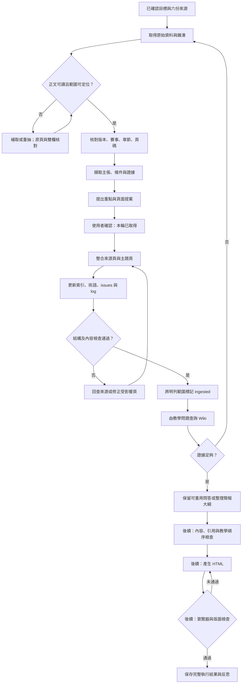

# 排球 LLM Wiki：流程、回圈與完成條件

本流程適用於 HW10。2026-11-22 的本輪任務是正式建立 Markdown Wiki；圖中的簡報與瀏覽器節點尚未執行。實際結果見 [Wiki log](../wiki/log.md) 與 [檢查紀錄](checks/ingest-2026-11-22.md)。

**最新進度（2026-11-22）：**下文保留 Wiki 入庫階段的流程脈絡。後續簡報已通過 H1／H2，完成 18 頁 HTML、正式圖解及實際瀏覽器檢查，見 [簡報 graph v1.1](slides-graph.md)、[HTML 實測](checks/html-review-2026-11-22.md) 與 [反思](reflection.md)。本次因 HTML01 將必要內容非空檢查前移至 J0；並將初始頁面與展開狀態分開檢查。原段落中的「後續／未執行」描述入庫當時，不代表目前仍未完成。

## 三層資料與三種操作

| 層次／操作 | 責任 | 本輪對應 |
| --- | --- | --- |
| `raw/` | 保存可追溯原始快照，衍生文字另存 | S01–S06；V01／V02 只作補查 |
| `wiki/` | 持久化概念、來源、交叉連結與未知事項 | 12 個主題頁、6 個來源頁、索引及維護頁 |
| `AGENTS.md` | 決定範圍、證據規則與工作流程 | 已加入雙欄及章節名稱檢查細節 |
| ingest | 新資料先讀取、定位，再整合既有概念並更新紀錄 | 本次六份來源的正式入庫 |
| query | 先查索引與 Wiki，帶來源回答；可重用問答留存 | 本輪另做一個跨頁查詢實例 |
| lint | 檢查結構、引用、版本、概念與教學表達 | 程式檢查加逐項內容核對 |

## Graph

討論節點已經完成授權，不會每建立一頁就重新要求確認。新來源若改變主題範圍或產生重大未解衝突，再釐清對應問題。

## 回圈如何判斷與退出？

| 回圈 | 觸發條件 | 回到哪裡 | 可以繼續的條件 |
| --- | --- | --- | --- |
| 取得／抽取 | 網路錯誤、正文空白、雙欄交錯、圖表無法理解 | 原始網址、其他可行讀取方式或原頁 | 有可讀正文與可核對定位；仍不行則記 `blocked` 或排除範圍 |
| 主張／證據 | 條號不支持、漏掉例外、版本或賽事混用 | 條文、原頁或後續規程 | 能保留條件並說明適用範圍；未解者放 issues，不進確定性主線 |
| Wiki 整合 | 死連結、孤立頁、來源未被使用、跨頁矛盾 | 來源頁、主題頁、索引 | 來源被實質整合，連結及相關內容一致 |
| query | Wiki 找不到答案或證據不足 | 先查原文，必要時取得新來源再 ingest | 能帶來源回答，或明確說明未知而不臆造 |
| 簡報 | 教學順序不清、來源缺口或圖解矛盾 | 大綱／Wiki／原文 | 每頁可追溯且適合初學者；此回圈尚待後續執行 |

未知出版年不等於整份來源不可用；但不能猜年份。特定賽事程序有差異時，可以保留差異並限制教學用途，不能把未解部分改成全球通則。

## 程式能檢查什麼？

[lint_wiki.py](../scripts/lint_wiki.py) 檢查檔案與 metadata、相對連結及 PDF 頁數、索引可達性、來源與主題的雙向對應、原始檔雜湊及登錄狀態。它不能判斷扣球規則的文字解釋是否完整，也不能證明某個教練觀點普遍正確。

因此另做內容核對：S01 的輪轉／前後排／自由球員條件；S02 的舊規則與技術觀點；S03 的章節和攻擊圖編碼；S04／S05 的作者歸屬；S06 的解釋、測試與後續賽事範圍。結果與實際修正寫進 [本輪檢查](checks/ingest-2026-11-22.md)。

## 本次真正調整了什麼？

初始規劃本來就把版本與適用範圍檢查前移，不能當成事後才發現的成果。本輪落實兩項操作細節：

1. 前置執行遇到 S02 雙欄交錯後，在摘要前增加原頁確認、分欄抽取與樣本複查。
2. 正式整合時發現 S03 前置摘要的章節標記不精確，修正為 III §10 與 IV，並把「目錄＋章首頁＋頁碼核對」列為摘要前檢查。

這些方法已寫回 [AGENTS.md](../AGENTS.md)。本輪有在受影響來源重新核對，尚未驗證完整簡報製作的成效；最後作業反思要等來源到 HTML 的實際流程完成後，再依紀錄統計。

[Wiki 索引](../wiki/index.md) · [專案入口](../README.md)
